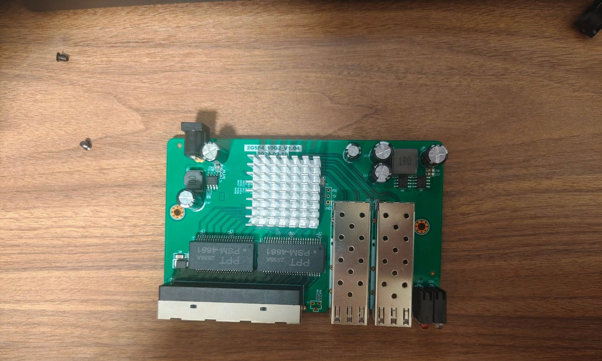
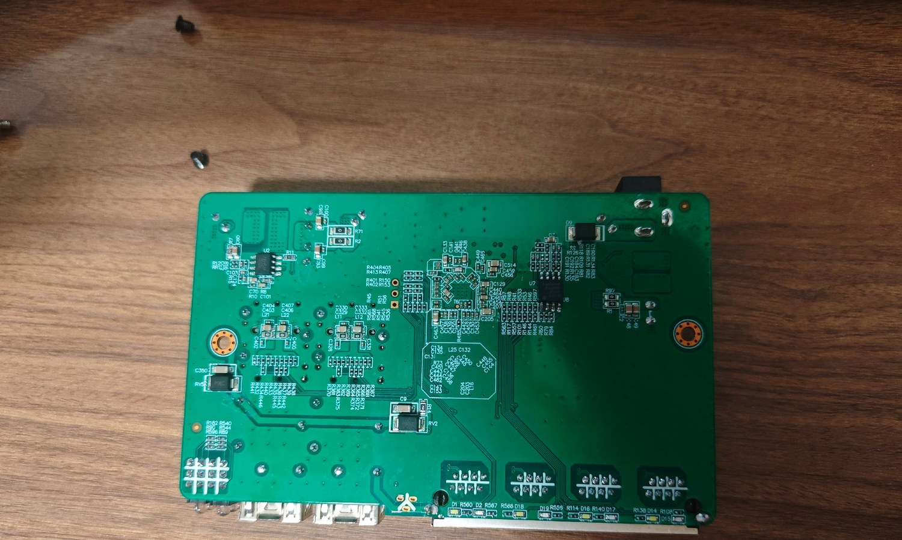
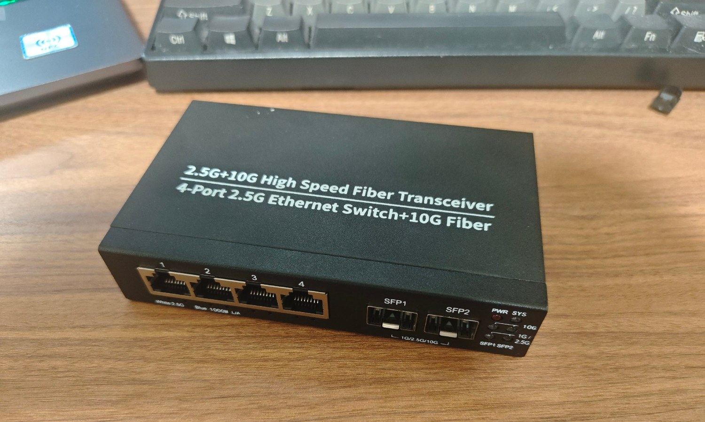

# 2G5F4_10G2_V1.04

Documentation for the unmanaged 4 + 2 switch sold as `HYWS-SGT0204S`. The PCB is
silkscreened `2G5F4_10G2_V1.04`, with `2024.09.19` below it, which is why the
document follows its PCB name and the machine carries a `V1_04` suffix - the V1.01
revision of the same product is already in the tree.

### Brands

| Brand | Type | Managed | PCB | Flash | Chip RTL |
|-------|------|---------|-----|-------|----------|
| hongyavision | HYWS-SGT0204S | No | 2G5F4_10G2_V1.04 | 4 Mbit / 512 KB stock | 8372 |

### What works

- all four 2.5GBASE-T RJ45 ports at 10/100/1000/2500 Mbps
- both SFP+ cages with 10G multimode and 10G copper modules, passing traffic to
  2.5G peers
- Web UI, VLAN, configuration save and reboot

### Not verified

- the copper ports have a white `2.5G` lamp and a blue `1000M L/A` lamp; the SFP+
  cages share a single indicator for `1G / 2.5G / 10G`
- a 1G or 2.5G SFP module has not been inserted yet, so the lower SFP rates are
  untested
- the SFP LOS inputs are kept from the upstream V1.01 profile and were not
  verified individually

### Known problem

Three of the thirteen lamps on the chassis cannot be driven from the LED mux. The
port table, the mux table and the wiring were checked repeatedly; the three lamps
stay dark no matter what is written. The rest of the box, including every port and
the Web UI, is unaffected. This is documented rather than hidden so the next person
knows it is a real limitation and not a build problem.

### Build target

```
make MACHINE=HONGYAVISION_HYWS_SGT0204S_V1_04
```

### Ports

```text
physical RJ45 1-4              -> logical 4-7
SFP1 (left,  physical 5)       -> logical 8, SDS1, detect GPIO38
SFP2 (right, physical 6)       -> logical 3, SDS0, detect GPIO37
```

The V1.01 profile in the tree uses `GPIO30` / `GPIO50` for the SFP detect inputs.
On this board the two inputs are `GPIO38` and `GPIO37`: reading `gpio` before and
after inserting a module shows exactly those two lines changing, and with the V1.01
pins the `sfp` command reported both cages as empty and neither passed traffic.

SFP I2C:

```text
SFP1 = GPIO39 (SDA4) / GPIO40 (SCL3)
SFP2 = GPIO41 (SDA3) / GPIO40 (SCL3)
```

TX disable is not connected on either cage.

### LEDs

The front panel legend reads `White : 2.5G` and `Blue : 1000M L/A` for the copper
ports, and `1G / 2.5G / 10G` for the shared SFP indicator, plus `PWR` and `SYS`.

### Flash

The board has no factory MAC: this is an unmanaged device and the stock firmware
stores none, so `mac_flash_offset` is left at `0` and the address is derived from
the chip UUID (locally administered, `06:` prefix), stable per unit.

The stock part is a 4 Mbit one that needs single-IO reads (`flash_sio = 1`). The
unit documented here has a 4 MB part fitted by the submitter, so the photos show
that part rather than the stock chip; the 512 KB image fits either way.

### PCB overview

Top side, silkscreen `2G5F4_10G2_V1.04` at the top edge:



Bottom side:



### Device



The case is labelled `2.5G+10G High Speed Fiber Transceiver` / `4-Port 2.5G
Ethernet Switch+10G Fiber`, with the port legend described above. 12 V supply,
metal case, external power brick.

### Hardware notes

- 2 x `PPT PSM-4881` 2.5G port modules
- RTL8372 with RTL8224 PHYs
- 12 V external supply, metal case